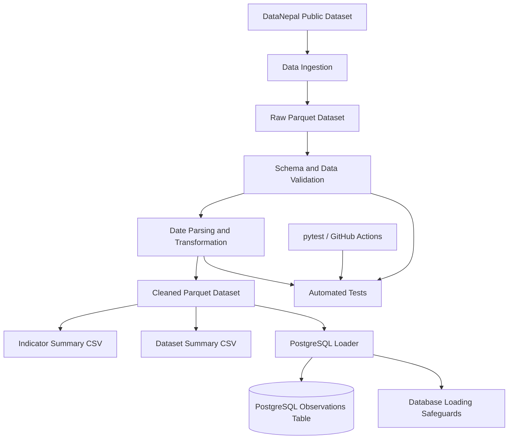

# Nepal Public Data Pipeline

**A Reproducible Data Engineering Pipeline for Public Data from Nepal**

A Python-based data engineering project that ingests, validates, transforms, summarizes, and stores public observations about Nepal using pandas, Apache Parquet, PostgreSQL, Docker, and pytest.

The project demonstrates practical data engineering concepts, including data-quality validation, analytical transformations, relational storage, containerized execution, automated testing, and continuous integration.

<p align="center">
  
</p>

<p align="center">
  <a href="docs/images/nepal-data-pipeline-architecture1.svg">View the full-resolution architecture diagram (SVG)</a>
</p>

## Table of Contents

- [Project Overview](#project-overview)
- [Key Features](#key-features)
- [Technology Stack](#technology-stack)
- [Architecture and Workflow](#architecture-and-workflow)
- [Data Source](#data-source)
- [Data Validation](#data-validation)
- [Generated Outputs](#generated-outputs)
- [Getting Started](#getting-started)
- [Running with Docker](#running-with-docker)
- [Loading Data into PostgreSQL](#loading-data-into-postgresql)
- [Testing and Continuous Integration](#testing-and-continuous-integration)
- [Verified Results](#verified-results)
- [Engineering Decisions](#engineering-decisions)
- [Limitations and Future Improvements](#limitations-and-future-improvements)
- [Data Attribution and Licensing](#data-attribution-and-licensing)
- [Author](#author)

## Project Overview

Public datasets become more useful when they can be processed consistently, checked for structural problems, and prepared for downstream analysis.

This project implements a repeatable pipeline for public observations about Nepal. It separates ingestion, validation, transformation, analytical summarization, and database loading into distinct stages.

The standard pipeline produces cleaned analytical data and summary reports. A separate database loader supports persistence in PostgreSQL.

The focus is on **data engineering fundamentals**, not on developing a machine-learning model.

## Key Features

- **Data ingestion:** Downloads a public Parquet dataset and validates its structure before saving it.
- **Data validation:** Checks required columns, missing identifiers, duplicate observation IDs, observation values, and date consistency.
- **Data transformation:** Parses observation-period dates and writes a cleaned Parquet dataset.
- **Analytical summaries:** Generates indicator-level and dataset-level CSV reports.
- **PostgreSQL integration:** Loads cleaned observations into a relational database through a separate loader.
- **Safe loading:** Refuses to load data into an already populated target table, helping prevent accidental duplicate loading.
- **Docker support:** Provides containerized PostgreSQL and an optional pipeline service through Docker Compose.
- **Automated testing:** Uses pytest to verify pipeline, transformation, ingestion, and database-loader behavior.
- **Continuous integration:** Includes a GitHub Actions workflow for running tests on pushes and pull requests targeting `main`.

## Technology Stack

| Component | Technology |
|---|---|
| Programming language | Python 3.12 |
| Data processing | pandas |
| Analytical storage | Apache Parquet |
| Parquet engine | PyArrow |
| Relational database | PostgreSQL |
| Database driver | psycopg |
| Containerization | Docker, Docker Compose |
| Testing | pytest |
| Continuous integration | GitHub Actions |
| Data source | DataNepal |

## Architecture and Workflow

The pipeline separates data preparation from database persistence.



### Processing stages

1. **Ingestion:** Downloads the upstream dataset when ingestion is requested and the raw input file is missing.
2. **Validation:** Checks required fields, identifiers, observation values, and observation-period consistency.
3. **Transformation:** Parses date fields and writes the cleaned Parquet output.
4. **Summarization:** Produces indicator-level and dataset-level CSV reports.
5. **Persistence:** Loads cleaned observations into PostgreSQL through a separate loader.
6. **Verification:** Uses automated tests and database checks to evaluate correctness and data integrity.

## Data Source

The project uses the public observations dataset published by [DataNepal](https://datanepal.org/).

- **Dataset:** [observations.parquet](https://datanepal.org/data/observations.parquet)
- **Format:** Apache Parquet
- **Coverage:** Observations from multiple datasets concerning Nepal

The ingestion code expects these dataset identifiers:

- `nso-nphc-2021`
- `cod-ps-npl`
- `worldbank-npl`
- `ecn-hor-2026`

The upstream dataset can change independently. Row counts and dataset composition should therefore be treated as a snapshot rather than permanent values.

## Data Validation

The pipeline validates incoming observations before generating downstream outputs.

Current checks include:

- Required-column validation
- Missing-value checks for required identifiers and fields
- Duplicate observation ID detection
- Numeric or textual observation-value validation
- Date parsing and invalid-date detection
- Observation-period consistency checks, including end dates preceding start dates

These checks help detect structural and consistency problems. They do not guarantee the semantic accuracy of every observation published by an upstream source.

## Generated Outputs

| Artifact | Purpose |
|---|---|
| `data/raw/observations.parquet` | Raw input dataset |
| `data/processed/observations_clean.parquet` | Validated and cleaned observations |
| `data/processed/indicator_summary.csv` | Indicator-level summary |
| `data/processed/dataset_summary.csv` | Dataset-level summary |
| `logs/pipeline.log` | Pipeline execution log |

The raw and processed data files are generated locally and excluded from Git by `.gitignore`. This keeps large datasets out of the repository by default.

## Getting Started

### Prerequisites

- Python 3.12
- Git
- Internet access if downloading the source dataset
- Docker Desktop for the containerized PostgreSQL setup

### 1. Clone the repository

```powershell
git clone https://github.com/manish11111111/nepal-data-pipeline.git
cd nepal-data-pipeline
```

### 2. Create a virtual environment

```powershell
python -m venv .venv
```

Activate it in Windows PowerShell:

```powershell
.\.venv\Scripts\Activate.ps1
```

If PowerShell blocks activation, use the virtual environment's Python executable directly.

### 3. Install dependencies

```powershell
python -m pip install --upgrade pip
python -m pip install -r requirements.txt
```

If the environment is not activated:

```powershell
.\.venv\Scripts\python.exe -m pip install -r requirements.txt
```

### 4. Run the pipeline

From the repository root, run:

```powershell
python -m src.pipeline
```

If the raw input file does not exist and you want the pipeline to download it first:

```powershell
python -m src.pipeline --ingest
```

The `--ingest` option downloads the dataset only when the selected raw input is missing. It does not force-refresh an existing raw file.

To download and validate the source dataset independently:

```powershell
python -m src.ingest_data
```

To replace the ingestion output intentionally after successful validation:

```powershell
python -m src.ingest_data --force
```

### Pipeline options

| Option | Description |
|---|---|
| `--ingest` | Download the dataset if the selected raw input is missing |
| `--input PATH` | Specify a custom raw input path |
| `--output PATH` | Specify a custom cleaned output path |
| `--no-summaries` | Skip summary generation |

For example, to process an existing raw dataset without generating summary reports:

```powershell
python -m src.pipeline --no-summaries
```

## Running with Docker

Docker Compose defines a PostgreSQL service and an optional pipeline container.

### 1. Configure the database password

Create a `.env` file in the project root:

```dotenv
POSTGRES_PASSWORD=replace_with_a_strong_local_password
```

Use a strong local password. Never commit `.env` or expose database credentials in source control.

### 2. Start PostgreSQL

```powershell
docker compose up -d db
```

Check the service status:

```powershell
docker compose ps
```

Wait until PostgreSQL reports a healthy status.

### 3. Build the pipeline image

```powershell
docker compose --profile pipeline build pipeline
```

### 4. Run the containerized pipeline

```powershell
docker compose --profile pipeline run --rm pipeline
```

The pipeline runs inside a temporary container. The configured data and log directories are mounted from the project directory.

**Important:** The standard transformation pipeline does not automatically load observations into PostgreSQL. Database loading is a separate step.

### Database connection settings

| Setting | Value |
|---|---|
| Database | `nepal_data` |
| Database user | `pipeline_user` |
| Host port | `5433` |
| Container port | `5432` |
| Compose database hostname | `db` |

For a local connection check, use:

```powershell
python -m src.check_postgres_connection
```

Use the database settings expected by the connection-check script.

## Loading Data into PostgreSQL

After the cleaned Parquet file has been generated and PostgreSQL is running, execute the loader through the configured pipeline container:

```powershell
docker compose --profile pipeline run --rm --no-deps --entrypoint python pipeline src/load_to_postgres.py
```

The loader reads the cleaned dataset and writes observations into the PostgreSQL `observations` table.

**Safety safeguard:** The loader intentionally stops if the target table already contains records. This helps prevent accidental duplicate loading.

If the loader reports that the table is already populated, inspect the existing database state rather than dropping or truncating the table just to rerun the command.

Incremental loading, upserts, and automated reconciliation between changed source data and existing database records are not currently implemented.

## Testing and Continuous Integration

Run the automated test suite from the repository root:

```powershell
python -m pytest -v
```

If you are not using the activated virtual environment:

```powershell
.\.venv\Scripts\python.exe -m pytest
```

The test suite covers core behavior such as:

- Data validation and invalid records
- Missing-input handling
- Ingestion behavior
- Custom input and output paths
- Summary generation
- PostgreSQL loader success and failure cases
- Duplicate-loading protection
- Row-count consistency checks

### GitHub Actions

The repository includes a GitHub Actions workflow at `.github/workflows/tests.yml`. It configures Python 3.12, installs dependencies, and runs pytest for pushes and pull requests targeting `main`.

- [GitHub repository](https://github.com/manish11111111/nepal-data-pipeline)
- [GitHub Actions runs](https://github.com/manish11111111/nepal-data-pipeline/actions)

The Actions page should be checked to confirm the status of the latest remote workflow run.

## Verified Results

The following results were observed during local development verification.

| Check | Result |
|---|---:|
| Raw observations processed | 27,182 |
| Cleaned observations | 27,182 |
| Cleaned dataset columns | 12 |
| Duplicate observation IDs | 0 |
| Invalid observation-period ranges | 0 |
| Rows missing both numeric and textual values | 0 |
| Indicator summary rows | 37 |
| Dataset summary rows | 4 |
| Automated tests | 25 passed |

The PostgreSQL table was also verified to contain 27,182 observations, with unique, non-null observation IDs.

These results describe the dataset snapshot tested during development. They do not guarantee that future source data will produce identical counts or values.

## Engineering Decisions

### Separation of concerns

Ingestion, validation, transformation, and database loading are separate operations. This makes individual stages easier to test and allows data preparation to run independently of database writes.

### Validation before downstream processing

The pipeline checks the structure and consistency of incoming observations before producing analytical outputs.

### Columnar analytical storage

Parquet is used to store structured observations efficiently and provide a consistent input for subsequent processing.

### Relational persistence

PostgreSQL provides relational storage for cleaned observations and supports downstream querying.

### Safe initial loading

The loader refuses to write into an already populated target table rather than silently risking duplicate records.

### Reproducible execution

Python dependencies, Docker configuration, and automated tests support repeatable development and verification.

## Limitations and Future Improvements

This project is a local, reproducible data pipeline rather than a production-scale orchestration platform.

Potential improvements include:

- Stronger schema contracts and explicit type validation
- Dataset version tracking and ingestion timestamps
- Incremental loading and change detection
- Upsert-based database synchronization
- Expanded database integration tests
- Docker-based CI verification
- Data freshness monitoring and quality metrics
- A small sample dataset for easier local testing
- Workflow scheduling and orchestration
- A dashboard for exploring indicators and datasets

## Data Attribution and Licensing

The data is sourced from [DataNepal](https://datanepal.org/).

- [DataNepal website](https://datanepal.org/)
- [Public observations dataset](https://datanepal.org/data/observations.parquet)

Review the applicable upstream terms, attribution requirements, and data licenses before redistributing source data.

This repository does not currently include a `LICENSE` file. No open-source license should be assumed for the project code unless one is explicitly added.

## Author

**Manish Chapagain**

Computer Engineering graduate interested in data engineering, artificial intelligence, and data-driven applications.

- [GitHub](https://github.com/manish11111111)
- [LinkedIn](https://linkedin.com/in/manish-chapagain-467451284)
