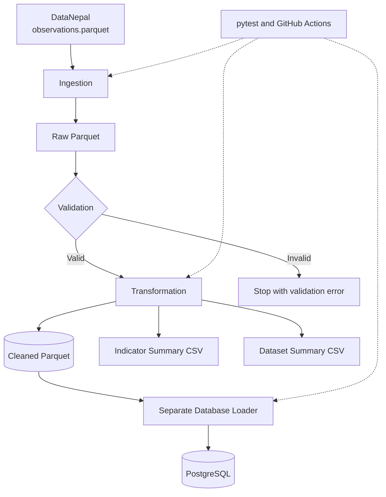

# Nepal Public Data Pipeline

**A reproducible data engineering pipeline for public observations about Nepal.**

A Python-based ETL pipeline that ingests, validates, transforms, summarizes, and stores public observations using **pandas, Apache Parquet, PostgreSQL, Docker Compose, and pytest**.

<p align="center">
  <a href="https://github.com/manish11111111/nepal-data-pipeline/actions/workflows/tests.yml">
    
  </a>
  
  
  
  
  
</p>

---

## Table of Contents

- [Overview](#overview)
- [Key Features](#key-features)
- [Technology Stack](#technology-stack)
- [Architecture](#architecture)
- [Data Source](#data-source)
- [Data Validation](#data-validation)
- [Generated Outputs](#generated-outputs)
- [Getting Started](#getting-started)
- [Running with Docker](#running-with-docker)
- [Loading Data into PostgreSQL](#loading-data-into-postgresql)
- [Testing and Continuous Integration](#testing-and-continuous-integration)
- [Verified Results](#verified-results)
- [Engineering Decisions](#engineering-decisions)
- [Limitations and Roadmap](#limitations-and-roadmap)
- [Data Attribution and Licensing](#data-attribution-and-licensing)
- [Author](#author)

---

## Overview

Public datasets are more useful when they can be processed consistently, validated before analysis, and stored in formats suitable for downstream applications.

This project implements a reproducible pipeline for public observations about Nepal. It separates data ingestion, validation, transformation, summarization, and database persistence into distinct operations.

The standard workflow produces a cleaned Parquet dataset and CSV summary reports. A separate database loader writes the processed observations to PostgreSQL.

The primary focus is data engineering: reliable data preparation, validation, safe database loading, automated testing, and reproducible execution.

## Key Features

| Component | Capability |
|---|---|
| Data ingestion | Downloads the upstream Parquet dataset and validates its structure |
| Data validation | Checks required fields, identifiers, observation values, and date consistency |
| Transformation | Parses observation periods and produces cleaned analytical data |
| Data summarization | Generates indicator-level and dataset-level CSV reports |
| Analytical storage | Uses Apache Parquet for structured observation data |
| Relational persistence | Loads cleaned observations into PostgreSQL through a separate loader |
| Loading safeguards | Prevents initial loading into an already populated target table |
| Containerization | Uses Docker Compose for PostgreSQL and the optional pipeline service |
| Automated testing | Tests pipeline behavior, transformations, ingestion, and database loading |
| Continuous integration | Runs pytest through GitHub Actions on pushes and pull requests targeting `main` |

## Technology Stack

| Layer | Technology |
|---|---|
| Language | Python |
| Data manipulation | pandas |
| Columnar storage | Apache Parquet, PyArrow |
| Database | PostgreSQL |
| Database driver | psycopg |
| Containerization | Docker, Docker Compose |
| Testing | pytest |
| Continuous integration | GitHub Actions |
| Upstream data | [DataNepal](https://datanepal.org/) |

## Architecture

The project separates data preparation from database persistence.



### Pipeline stages

1. **Ingestion:** Retrieves the public dataset when required.
2. **Validation:** Checks structure and consistency before downstream processing.
3. **Transformation:** Parses date fields and writes cleaned observations.
4. **Summarization:** Generates indicator-level and dataset-level reports.
5. **Persistence:** Loads cleaned observations into PostgreSQL through a separate operation.
6. **Verification:** Automated tests check expected behavior and failure cases.

The regular pipeline does not automatically write to PostgreSQL. This keeps data preparation independent of database operations.

## Data Source

The pipeline uses the public observations dataset published by [DataNepal](https://datanepal.org/).

- **Source file:** [`observations.parquet`](https://datanepal.org/data/observations.parquet)
- **Format:** Apache Parquet
- **Coverage:** Observations from multiple datasets concerning Nepal

The ingestion process expects these dataset identifiers:

- `nso-nphc-2021`
- `cod-ps-npl`
- `worldbank-npl`
- `ecn-hor-2026`

The upstream source can change over time. Reported counts therefore describe the snapshot used during development rather than permanent dataset properties.

## Data Validation

Before generating analytical outputs, the pipeline checks:

- Required-column presence
- Missing required identifiers and fields
- Duplicate observation IDs
- Numeric or textual observation values
- Date parsing and invalid dates
- Observation periods with end dates preceding start dates

These checks help detect structural and consistency problems. They do not guarantee the semantic accuracy of every upstream observation.

## Generated Outputs

| Path | Purpose |
|---|---|
| `data/raw/observations.parquet` | Raw input observations |
| `data/processed/observations_clean.parquet` | Validated and transformed observations |
| `data/processed/indicator_summary.csv` | Indicator-level summary report |
| `data/processed/dataset_summary.csv` | Dataset-level summary report |
| `logs/pipeline.log` | Pipeline execution logs |

Generated data files are excluded from Git through `.gitignore`. This keeps large data artifacts out of the source repository, but means a fresh clone must generate or download the data before running the pipeline.

## Getting Started

### Prerequisites

- Python 3.12 or later
- Git
- Internet access for downloading the upstream dataset
- Docker Desktop for the containerized PostgreSQL setup

### 1. Clone the repository

```bash
git clone https://github.com/manish11111111/nepal-data-pipeline.git
cd nepal-data-pipeline
```

### 2. Create a virtual environment

**Windows PowerShell**

```powershell
python -m venv .venv
.\.venv\Scripts\Activate.ps1
```

If PowerShell blocks activation, use the virtual environment's Python executable directly.

**macOS or Linux**

```bash
python3 -m venv .venv
source .venv/bin/activate
```

### 3. Install dependencies

```bash
python -m pip install --upgrade pip
python -m pip install -r requirements.txt
```

### 4. Download the source dataset

To download and validate the upstream dataset independently:

```bash
python -m src.ingest_data
```

To intentionally replace the ingestion output after successful validation:

```bash
python -m src.ingest_data --force
```

The force option should be used deliberately because it replaces the existing ingestion output.

### 5. Run the pipeline

```bash
python -m src.pipeline
```

If the raw input file is missing and you want the pipeline to download it automatically:

```bash
python -m src.pipeline --ingest
```

The `--ingest` option downloads the source only when the selected raw input is missing; it does not force-refresh an existing file.

### Pipeline options

| Option | Description |
|---|---|
| `--ingest` | Download the source dataset if the selected raw input is missing |
| `--input PATH` | Specify a custom raw input path |
| `--output PATH` | Specify a custom cleaned output path |
| `--no-summaries` | Skip summary generation |

Example:

```bash
python -m src.pipeline --no-summaries
```

## Running with Docker

Docker Compose provides a PostgreSQL service and an optional pipeline container.

### 1. Configure database credentials

Create a `.env` file in the project root:

```env
POSTGRES_PASSWORD=replace_with_a_strong_local_password
```

Never commit `.env` files or expose database credentials in source control.

### 2. Start PostgreSQL

```bash
docker compose up -d db
docker compose ps
```

Wait until the database reports a healthy status.

### 3. Build the pipeline image

```bash
docker compose --profile pipeline build pipeline
```

### 4. Run the containerized pipeline

```bash
docker compose --profile pipeline run --rm pipeline
```

The pipeline container uses the project configuration and mounted data directories.

**Important:** Running the standard pipeline does not automatically load observations into PostgreSQL.

### Database connection settings

| Setting | Value |
|---|---|
| Database | `nepal_data` |
| User | `pipeline_user` |
| Host port | `5433` |
| Container port | `5432` |
| Compose hostname | `db` |

To check a local database connection:

```bash
python -m src.check_postgres_connection
```

## Loading Data into PostgreSQL

After generating the cleaned Parquet file and starting PostgreSQL, run the separate loader:

```bash
docker compose --profile pipeline run --rm --no-deps --entrypoint python pipeline src/load_to_postgres.py
```

The loader reads the cleaned observations and writes them to the PostgreSQL `observations` table.

### Safe-loading behavior

The loader refuses to write into a target table that already contains records. This prevents accidental duplicate loading during initial setup.

If the loader reports that the table is populated, inspect the existing database state rather than dropping or truncating the table to rerun the operation.

Incremental loading, upserts, and automated reconciliation of changed source data are not currently implemented.

## Testing and Continuous Integration

Run the local test suite:

```bash
python -m pytest -v
```

Alternatively, on Windows without activating the virtual environment:

```powershell
.\.venv\Scripts\python.exe -m pytest
```

The tests cover:

- Data validation and invalid records
- Missing-input handling
- Ingestion behavior
- Custom input and output paths
- Summary generation
- PostgreSQL loader success and failure cases
- Duplicate-loading protection
- Row-count consistency

### GitHub Actions

The workflow at `.github/workflows/tests.yml` configures Python 3.12, installs project dependencies, and runs pytest on pushes and pull requests targeting `main`.

- [Repository](https://github.com/manish11111111/nepal-data-pipeline)
- [GitHub Actions workflow](https://github.com/manish11111111/nepal-data-pipeline/actions)

The workflow badge at the top reflects the latest workflow status; it is separate from the locally verified test count.

## Verified Results

The following results were recorded during local development verification:

| Metric | Result |
|---|---:|
| Raw observations processed | 27,182 |
| Cleaned observations | 27,182 |
| Cleaned dataset columns | 12 |
| Duplicate observation IDs | 0 |
| Invalid observation-period ranges | 0 |
| Rows missing both numeric and textual values | 0 |
| Indicator summary rows | 37 |
| Dataset summary rows | 4 |
| Automated tests passed | 25 |

The PostgreSQL table was also verified to contain **27,182 observations**, with unique, non-null observation IDs.

These results apply to the tested data snapshot. Counts may change when the upstream dataset is updated.

## Engineering Decisions

| Decision | Rationale |
|---|---|
| Separation of concerns | Makes individual pipeline stages easier to test and operate independently |
| Validation before processing | Prevents structurally invalid data from reaching downstream outputs |
| Parquet analytical storage | Provides a columnar format for structured observations |
| PostgreSQL persistence | Supports relational queries and downstream database consumers |
| Safe initial loading | Prevents accidental writes into an already populated target table |
| Automated testing | Helps detect regressions in validation, transformation, and loading behavior |
| Docker-based development | Makes the database and optional pipeline service easier to run consistently |
| GitHub Actions | Automates test execution on repository changes |

## Limitations and Roadmap

This project is a reproducible data pipeline, not a production-scale orchestration platform.

Planned improvements:

- [ ] Stronger schema contracts and explicit type validation
- [ ] Dataset version tracking and ingestion timestamps
- [ ] Incremental loading and change detection
- [ ] Upsert-based database synchronization
- [ ] Expanded database integration tests
- [ ] Docker-based CI verification
- [ ] Data freshness monitoring and quality metrics
- [ ] A small sample dataset for easier local testing
- [ ] Workflow scheduling and orchestration
- [ ] An interactive dashboard for exploring datasets and indicators

## Data Attribution and Licensing

The data is sourced from [DataNepal](https://datanepal.org/).

- [DataNepal website](https://datanepal.org/)
- [Public observations dataset](https://datanepal.org/data/observations.parquet)

Review the applicable upstream terms, attribution requirements, and data licences before redistributing source data.

This repository currently does not include a `LICENSE` file. Unless a licence is explicitly added, others should not assume the project code is released under an open-source licence.

## Author

**Manish Chapagain**

Computer Engineering graduate interested in data engineering, artificial intelligence, and data-driven applications.

- [GitHub](https://github.com/manish11111111)
- [LinkedIn](https://linkedin.com/in/manish-chapagain-467451284)

---

<p align="center">
  <sub>Built to practise reliable data engineering through validation, reproducibility, testing, and safe data persistence.</sub>
</p>