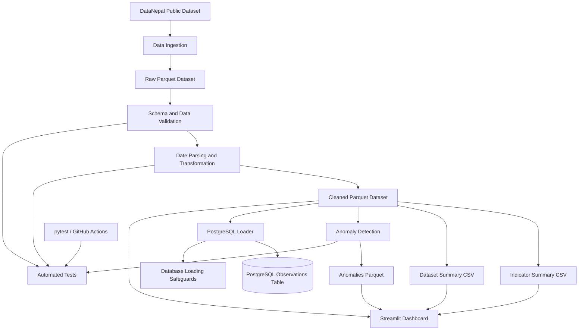

# 🇳🇵 Nepal Public Data Pipeline

**A reproducible data engineering pipeline for public observations about Nepal.**

Ingests, validates, transforms, summarizes, and stores public data, flags unusual values, and presents everything in an interactive dashboard. Built with **pandas, Apache Parquet, PostgreSQL, Docker, pytest, Streamlit, Plotly, and scikit-learn**.

[](https://github.com/manish11111111/nepal-data-pipeline/actions/workflows/tests.yml)


<p align="center">
  
</p>

<p align="center">
  <a href="docs/images/nepal-data-pipeline-architecture1.svg">View the full-resolution architecture diagram (SVG)</a>
</p>

---

## Table of Contents

- [Project Overview](#project-overview)
- [Key Features](#key-features)
- [Technology Stack](#technology-stack)
- [Architecture and Workflow](#architecture-and-workflow)
- [Streamlit Dashboard](#streamlit-dashboard)
- [Anomaly Detection](#anomaly-detection)
- [Data Source](#data-source)
- [Data Validation](#data-validation)
- [Generated Outputs](#generated-outputs)
- [Getting Started](#getting-started)
- [Running with Docker](#running-with-docker)
- [Loading Data into PostgreSQL](#loading-data-into-postgresql)
- [Testing and Continuous Integration](#testing-and-continuous-integration)
- [Verified Results](#verified-results)
- [Engineering Decisions](#engineering-decisions)
- [Limitations and Future Improvements](#limitations-and-future-improvements)
- [Data Attribution and Licensing](#data-attribution-and-licensing)
- [Author](#author)

---

## Project Overview

Public datasets become more useful when they can be processed consistently, checked for structural problems, and prepared for downstream analysis.

This project implements a repeatable pipeline for public observations about Nepal. It separates ingestion, validation, transformation, analytical summarization, anomaly detection, database loading, and dashboard presentation into distinct stages.

The standard pipeline produces cleaned analytical data and summary reports. A separate database loader supports persistence in PostgreSQL. An interactive Streamlit dashboard presents the pipeline outputs and data-quality signals.

> **Focus:** data engineering fundamentals, not machine-learning modelling. Anomaly detection is included as a **data-quality signal**, not as a predictive model.

---

## Key Features

| Area | What it does |
|---|---|
| **Ingestion** | Downloads a public Parquet dataset and validates its structure before saving it |
| **Validation** | Checks required columns, missing identifiers, duplicate observation IDs, observation values, and date consistency |
| **Transformation** | Parses observation-period dates and writes a cleaned Parquet dataset |
| **Summaries** | Generates indicator-level and dataset-level CSV reports |
| **Anomaly detection** | Flags unusual numeric values per indicator using Isolation Forest |
| **PostgreSQL** | Loads cleaned observations into a relational database through a separate loader |
| **Safe loading** | Refuses to load into an already populated table to prevent accidental duplicates |
| **Dashboard** | Multi-page Streamlit app for dataset summaries, indicator summaries, observation exploration, and data-quality signals |
| **Docker** | Containerized PostgreSQL and an optional pipeline service via Docker Compose |
| **Testing** | pytest coverage for the pipeline, transformation, ingestion, anomaly detection, and database loader |
| **CI** | GitHub Actions runs the tests on pushes and pull requests targeting `main` |

---

## Technology Stack

| Component | Technology |
|---|---|
| Programming language | Python 3.12+ |
| Data processing | pandas |
| Analytical storage | Apache Parquet |
| Parquet engine | PyArrow |
| Relational database | PostgreSQL |
| Database driver | psycopg |
| Anomaly detection | scikit-learn (Isolation Forest) |
| Dashboard | Streamlit |
| Charts | Plotly |
| Containerization | Docker, Docker Compose |
| Testing | pytest |
| Continuous integration | GitHub Actions |
| Data source | [DataNepal](https://datanepal.org/) |

---

## Architecture and Workflow

The pipeline separates data preparation, anomaly detection, database persistence, and presentation.



| Stage | Description |
|---|---|
| 1. Ingestion | Downloads the upstream dataset when requested and the raw file is missing |
| 2. Validation | Checks required fields, identifiers, observation values, and period consistency |
| 3. Transformation | Parses date fields and writes the cleaned Parquet output |
| 4. Summarization | Produces indicator-level and dataset-level CSV reports |
| 5. Anomaly detection | Flags unusual numeric values per indicator using Isolation Forest |
| 6. Persistence | Loads cleaned observations into PostgreSQL through a separate loader |
| 7. Presentation | Serves the outputs through a Streamlit dashboard |
| 8. Verification | Automated tests and database checks evaluate correctness and integrity |

---

## Streamlit Dashboard

A multi-page Streamlit app presents the pipeline outputs.

| Page | Purpose |
|---|---|
| **Home** | Project overview, KPI cards, anomaly summary |
| **Dataset** | Dataset-level aggregates and charts |
| **Indicators** | Indicator-level aggregates with observation counts and value statistics |
| **Explore** | Multi-filter exploration of cleaned observations with CSV download |
| **Quality** | Data-quality checks and anomaly detection results |
| **About** | Project context, pipeline stages, stack, and author |

Run it locally (after the pipeline and anomaly detection have produced their outputs):

```bash
streamlit run app.py
```

> The dashboard is **read-only**: it consumes pipeline outputs and does not modify the data or the database.

---

## Anomaly Detection

Anomaly detection flags unusual numeric observation values using **Isolation Forest**.

- **Per indicator:** a model is fitted for each indicator when it has enough rows.
- **Fallback:** a global model is used for indicators with too few rows.
- **Output:** `data/processed/anomalies.parquet`, with an added `is_anomaly` column.

Run it:

```bash
python -m src.anomaly_detection
```

The results appear on the **Quality** page of the dashboard.

> ⚠️ This is a data-quality signal, not a predictive model. It helps reviewers spot unusual values but does not replace domain validation.

---

## Data Source

The project uses the public observations dataset published by [DataNepal](https://datanepal.org/).

- **Dataset:** `observations.parquet`
- **Format:** Apache Parquet
- **Coverage:** Observations from multiple datasets concerning Nepal

The ingestion code expects these dataset identifiers:

```
nso-nphc-2021
cod-ps-npl
worldbank-npl
ecn-hor-2026
```

> ⚠️ The upstream dataset can change independently. Treat row counts and dataset composition as a **snapshot**, not permanent values.

---

## Data Validation

Incoming observations are validated before any downstream output is generated:

- ✅ Required-column validation
- ✅ Missing-value checks for required identifiers and fields
- ✅ Duplicate observation ID detection
- ✅ Numeric or textual observation-value validation
- ✅ Date parsing and invalid-date detection
- ✅ Observation-period consistency, including end dates preceding start dates

These checks detect structural and consistency problems. They do **not** guarantee the semantic accuracy of every observation published by the upstream source.

---

## Generated Outputs

| File | Description |
|---|---|
| `data/raw/observations.parquet` | Raw input dataset |
| `data/processed/observations_clean.parquet` | Validated and cleaned observations |
| `data/processed/indicator_summary.csv` | Indicator-level summary |
| `data/processed/dataset_summary.csv` | Dataset-level summary |
| `data/processed/anomalies.parquet` | Observations with an added `is_anomaly` flag |
| `logs/pipeline.log` | Pipeline execution log |

Raw and processed data files are generated locally and excluded from Git via `.gitignore`, keeping large datasets out of the repository.

---

## Getting Started

### Prerequisites

- Python 3.12+ (developed and tested on Python 3.12–3.15)
- Git
- Internet access (if downloading the source dataset)
- Docker Desktop (for the containerized PostgreSQL setup)

### 1. Clone the repository

```bash
git clone https://github.com/manish11111111/nepal-data-pipeline.git
cd nepal-data-pipeline
```

### 2. Create a virtual environment

```bash
python -m venv .venv
```

Activate it:

```powershell
# Windows PowerShell
.\.venv\Scripts\Activate.ps1
```

```bash
# macOS / Linux
source .venv/bin/activate
```

> If PowerShell blocks activation, call the virtual environment's Python directly, for example `.\.venv\Scripts\python.exe -m pip install -r requirements.txt`.

### 3. Install dependencies

```bash
python -m pip install --upgrade pip
python -m pip install -r requirements.txt
```

### 4. Run the pipeline

From the repository root:

```bash
python -m src.pipeline
```

If the raw input file does not exist and you want the pipeline to download it first:

```bash
python -m src.pipeline --ingest
```

> `--ingest` downloads the dataset only when the selected raw input is missing. It does not force-refresh an existing raw file.

To download and validate the source dataset on its own:

```bash
python -m src.ingest_data
```

To intentionally replace the ingestion output after successful validation:

```bash
python -m src.ingest_data --force
```

### 5. Run anomaly detection

```bash
python -m src.anomaly_detection
```

### 6. Launch the dashboard

```bash
streamlit run app.py
```

### Pipeline options

| Option | Description |
|---|---|
| `--ingest` | Download the dataset if the selected raw input is missing |
| `--input PATH` | Specify a custom raw input path |
| `--output PATH` | Specify a custom cleaned output path |
| `--no-summaries` | Skip summary generation |

Example, processing an existing raw dataset without summaries:

```bash
python -m src.pipeline --no-summaries
```

---

## Running with Docker

Docker Compose defines a PostgreSQL service and an optional pipeline container.

**1. Configure the database password.** Create a `.env` file in the project root:

```env
POSTGRES_PASSWORD=replace_with_a_strong_local_password
```

> 🔒 Use a strong local password. Never commit `.env` or expose database credentials in source control.

**2. Start PostgreSQL**

```bash
docker compose up -d db
docker compose ps
```

Wait until PostgreSQL reports a healthy status.

**3. Build the pipeline image**

```bash
docker compose --profile pipeline build pipeline
```

**4. Run the containerized pipeline**

```bash
docker compose --profile pipeline run --rm pipeline
```

The pipeline runs in a temporary container, with the data and log directories mounted from the project directory.

> **Important:** the standard pipeline does **not** load observations into PostgreSQL automatically. Database loading is a separate step.

### Database connection settings

| Setting | Value |
|---|---|
| Database | `nepal_data` |
| User | `pipeline_user` |
| Host port | `5433` |
| Container port | `5432` |
| Compose hostname | `db` |

For a local connection check:

```bash
python -m src.check_postgres_connection
```

---

## Loading Data into PostgreSQL

Once the cleaned Parquet file exists and PostgreSQL is running, run the loader through the pipeline container:

```bash
docker compose --profile pipeline run --rm --no-deps --entrypoint python pipeline src/load_to_postgres.py
```

The loader reads the cleaned dataset and writes observations into the PostgreSQL `observations` table.

> 🛡️ **Safety safeguard:** the loader intentionally stops if the target table already contains records. If this happens, inspect the existing database state instead of dropping or truncating the table just to rerun the command.

Incremental loading, upserts, and automated reconciliation between changed source data and existing database records are not currently implemented.

---

## Testing and Continuous Integration

Run the automated test suite from the repository root:

```bash
python -m pytest -v
```

Without an activated virtual environment:

```powershell
.\.venv\Scripts\python.exe -m pytest
```

**The tests cover:**

- Data validation and invalid records
- Missing-input handling
- Ingestion behavior
- Custom input and output paths
- Summary generation
- Anomaly detection
- PostgreSQL loader success and failure cases
- Duplicate-loading protection
- Row-count consistency checks

### GitHub Actions

The workflow at `.github/workflows/tests.yml` sets up Python 3.12, installs dependencies, and runs pytest on pushes and pull requests targeting `main`.

- Repository: <https://github.com/manish11111111/nepal-data-pipeline>
- Workflow runs: <https://github.com/manish11111111/nepal-data-pipeline/actions>

---

## Verified Results

Observed during local development verification:

| Metric | Result |
|---|---|
| Raw observations processed | 27,182 |
| Cleaned observations | 27,182 |
| Cleaned dataset columns | 12 |
| Duplicate observation IDs | 0 |
| Invalid observation-period ranges | 0 |
| Rows missing both numeric and textual values | 0 |
| Indicator summary rows | 37 |
| Dataset summary rows | 4 |
| Automated tests | _update with the current `pytest` count_ |

The PostgreSQL table was also verified to contain **27,182** observations, with unique, non-null observation IDs.

> These results describe the dataset snapshot tested during development. Future source data may produce different counts or values.

---

## Engineering Decisions

| Decision | Rationale |
|---|---|
| **Separation of concerns** | Ingestion, validation, transformation, anomaly detection, and loading are separate, making each stage easier to test and letting data preparation run without database writes |
| **Validate before processing** | Structure and consistency are checked before any analytical output is produced |
| **Columnar storage (Parquet)** | Efficient storage and a consistent input for subsequent processing |
| **Relational persistence (PostgreSQL)** | Relational storage for cleaned observations that supports downstream querying |
| **Safe initial loading** | The loader refuses to write into a populated table rather than silently risking duplicates |
| **Anomalies as a signal, not a verdict** | Isolation Forest flags values for human review; it does not delete or alter data |
| **Read-only dashboard** | The dashboard only consumes outputs, so exploring data can never corrupt it |
| **Reproducible execution** | Pinned dependencies, Docker configuration, and automated tests support repeatable development and verification |

---

## Limitations and Future Improvements

This is a local, reproducible pipeline, not a production-scale orchestration platform.

**Planned improvements**

- [ ] Stronger schema contracts and explicit type validation
- [ ] Dataset version tracking and ingestion timestamps
- [ ] Incremental loading and change detection
- [ ] Upsert-based database synchronization
- [ ] Expanded database integration tests
- [ ] Docker-based CI verification
- [ ] Data freshness monitoring and quality metrics
- [ ] A small sample dataset for easier local testing
- [ ] Workflow scheduling and orchestration
- [ ] Evaluation of anomaly-detection results against domain knowledge

---

## Data Attribution and Licensing

Data is sourced from [DataNepal](https://datanepal.org/).

- Website: <https://datanepal.org/>
- Dataset: <https://datanepal.org/data/observations.parquet>

Review the applicable upstream terms, attribution requirements, and data licenses before redistributing source data.

This repository does not currently include a `LICENSE` file. No open-source license should be assumed for the project code unless one is explicitly added.

---

## Author

**Manish Chapagain**

Computer Engineering graduate interested in data engineering, artificial intelligence, and data-driven applications.

[](https://github.com/manish11111111)
[](https://linkedin.com/in/manish-chapagain-467451284)