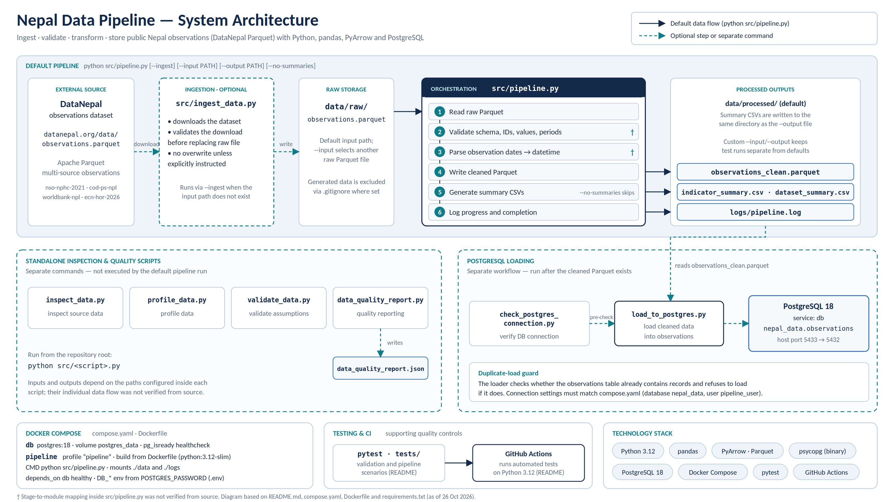

# Nepal Public Data Pipeline

A reproducible data engineering project that ingests, validates, transforms and stores public observations about Nepal. It uses Python, pandas and PyArrow for processing, Parquet for analytical storage, PostgreSQL for relational storage, Docker Compose for the local database, and pytest with GitHub Actions for automated testing.



*Editable vector version: [`docs/images/nepal-data-pipeline-architecture.svg`](docs/images/nepal-data-pipeline-architecture.svg)*

## Contents

- [Project objectives](#project-objectives)
- [What it does](#what-it-does)
- [Data source](#data-source)
- [Quick start](#quick-start)
- [Pipeline options](#pipeline-options)
- [Data validation](#data-validation)
- [Outputs](#outputs)
- [Logging](#logging)
- [Inspection and quality scripts](#inspection-and-quality-scripts)
- [PostgreSQL loading](#postgresql-loading)
- [Docker Compose](#docker-compose)
- [Testing and CI](#testing-and-ci)
- [Project structure](#project-structure)
- [Design considerations](#design-considerations)
- [Limitations](#limitations)
- [Roadmap](#roadmap)
- [License and data attribution](#license-and-data-attribution)
- [Author](#author)

## Project objectives

- Ingest public data about Nepal from a published Parquet dataset.
- Validate schemas, identifiers, values and observation periods.
- Transform raw observations into a cleaned analytical dataset.
- Generate indicator-level and dataset-level summary reports.
- Load processed observations into PostgreSQL.
- Automate pipeline execution and verify behaviour through tests.
- Provide a reproducible development environment using Docker.

## What it does

The default run (`python src/pipeline.py`) performs these steps:

1. Reads the selected raw Parquet file.
2. Validates the schema and observation records (required columns, identifiers, unique observation IDs, values and observation periods).
3. Parses date fields into datetime types.
4. Writes the cleaned Parquet dataset.
5. Generates indicator-level and dataset-level summary CSVs (can be skipped).
6. Logs progress and completion to `logs/pipeline.log`.

Ingestion, quality profiling and PostgreSQL loading are separate from this default run:

| Workflow | Command | Runs by default? |
|---|---|---|
| Core pipeline | `python src/pipeline.py` | Yes |
| Download the dataset first | `python src/pipeline.py --ingest` | Only with `--ingest` |
| Inspection, profiling, quality report | `python src/<script>.py` | No, separate commands |
| Load cleaned data into PostgreSQL | `python src/load_to_postgres.py` | No, separate command |

## Data source

The pipeline uses the published [DataNepal](https://datanepal.org) observations dataset:

- **File:** <https://datanepal.org/data/observations.parquet>
- **Format:** Apache Parquet
- **Content:** structured observations from several datasets, identified by IDs such as `nso-nphc-2021`, `cod-ps-npl`, `worldbank-npl` and `ecn-hor-2026`

The ingestion script validates the downloaded file before it is accepted as raw input, and existing raw data is not overwritten unless the script is explicitly instructed to do so.

### Dataset snapshot

These figures come from the locally verified dataset used during development. They are not guaranteed to stay the same, because the upstream dataset may change.

| Metric | Result |
|---|---:|
| Observations | 27,182 |
| Columns | 12 |
| Unique indicators | 36 |
| Unique places | 838 |
| Duplicate observation IDs | 0 |
| Duplicate rows | 0 |

| Dataset ID | Observations |
|---|---:|
| `nso-nphc-2021` | 21,258 |
| `cod-ps-npl` | 4,590 |
| `worldbank-npl` | 1,213 |
| `ecn-hor-2026` | 121 |
| **Total** | **27,182** |

## Quick start

**Prerequisites:** Python 3.12 (or a compatible version), Git, and Docker Desktop if you want the PostgreSQL service.

```bash
git clone https://github.com/manish11111111/nepal-data-pipeline.git
cd nepal-data-pipeline

python -m venv .venv
# Windows PowerShell:  .\.venv\Scripts\Activate.ps1
# macOS / Linux:       source .venv/bin/activate

python -m pip install --upgrade pip
pip install -r requirements.txt
```

Download the dataset and run the pipeline:

```bash
python src/pipeline.py --ingest
```

If `data/raw/` already contains the raw Parquet file, run it without `--ingest`:

```bash
python src/pipeline.py
```

## Pipeline options

| Option | Purpose |
|---|---|
| `--ingest` | Download the dataset when the selected input path does not exist |
| `--input PATH` | Use a different raw Parquet file instead of the default |
| `--output PATH` | Write the cleaned Parquet file to a different path |
| `--no-summaries` | Skip generation of the summary CSVs |

If `--input` or `--output` is omitted, the corresponding default project path is used. When summaries are enabled, they are written to the same directory as the output Parquet file.

Example of an isolated run that leaves the default outputs untouched (in PowerShell, use a backtick `` ` `` instead of `\` for line continuation and `.\` style paths if you prefer):

```bash
python src/pipeline.py \
  --input data/raw/observations_e2e_test.parquet \
  --output data/processed/e2e_test/observations_clean.parquet
```

## Data validation

The validation logic checks these integrity conditions:

- Required columns are present.
- Observation and dataset identifiers are populated.
- Required status and period fields are available.
- Observation IDs are unique.
- Each record contains a numeric or textual value.
- Observation dates can be parsed.
- Observation end dates are not earlier than their start dates.

These checks detect malformed or inconsistent data before it moves further through the pipeline. The ingestion step applies its own check to the downloaded file before it replaces the target raw file.

## Outputs

| Artifact | Description |
|---|---|
| `data/processed/observations_clean.parquet` | Validated dataset with parsed dates |
| `data/processed/indicator_summary.csv` | Observations grouped by dataset, indicator and unit |
| `data/processed/dataset_summary.csv` | Observations grouped by dataset, status and period type |
| `data/processed/data_quality_report.json` | Produced by the separate quality report script |
| `logs/pipeline.log` | Execution log |

Generated data and logs are excluded from version control where configured in `.gitignore`. Exact outputs depend on which scripts have been run and on the chosen output directory.

## Logging

Pipeline progress and errors are written to `logs/pipeline.log`, which helps trace ingestion, validation, transformation, output creation and completion.

## Inspection and quality scripts

These scripts are run separately from the main pipeline, from the repository root:

```bash
python src/inspect_data.py
python src/profile_data.py
python src/validate_data.py
python src/data_quality_report.py
```

Their inputs and outputs depend on the paths configured inside each script.

## PostgreSQL loading

PostgreSQL loading is a separate step, so data processing and database operations can be managed independently.

1. Create a local `.env` file containing the password for the Compose database (never commit it):

   ```
   POSTGRES_PASSWORD=replace_with_a_strong_local_password
   ```

2. Start the database:

   ```bash
   docker compose up -d db
   ```

3. Check the connection:

   ```bash
   python src/check_postgres_connection.py
   ```

4. Load the cleaned data (run `python src/pipeline.py` first so `observations_clean.parquet` exists):

   ```bash
   python src/load_to_postgres.py
   ```

The loader writes to the `observations` table and **refuses to load if that table already contains records**, which prevents accidental duplicate loads. Connection settings must match `compose.yaml`: database `nepal_data`, user `pipeline_user`, host port `5433`.

To stop the services while keeping the database volume:

```bash
docker compose down
```

Do not use `docker compose down -v` unless you intentionally want to delete the stored database.

## Docker Compose

`compose.yaml` defines two services:

| Service | Details |
|---|---|
| `db` | `postgres:18`, database `nepal_data`, user `pipeline_user`, host port `5433` mapped to `5432`, named volume `postgres_data`, `pg_isready` healthcheck |
| `pipeline` | Built from the `Dockerfile` (`python:3.12-slim`), default command `python src/pipeline.py`, mounts `./data` and `./logs`, receives `DB_*` environment variables, starts after `db` is healthy. Enabled through the `pipeline` profile |

Run the containerised pipeline:

```bash
docker compose --profile pipeline run --rm pipeline
```

The raw dataset must be available under `./data` (or ingested) because the container reads and writes through the mounted volume.

## Testing and CI

Run the automated tests:

```bash
python -m pytest -v
```

The tests cover validation behaviour and pipeline scenarios, including missing raw files, ingestion behaviour and skipping summary generation.

### Results observed during local development

- An end-to-end run completed successfully using a separate test input and output directory.
- The cleaned dataset contained 27,182 rows and 12 columns.
- The indicator summary contained 37 rows and the dataset summary contained 4 rows.
- All 27,182 observation IDs were unique.

Run `python -m pytest -v` to see the current test results for your checkout. Test counts change as regression tests are added. GitHub Actions runs the test suite on Python 3.12; see the [Actions tab](https://github.com/manish11111111/nepal-data-pipeline/actions) for the latest status.

## Project structure

```
nepal-data-pipeline/
├── .github/workflows/        # CI workflow
├── data/
│   ├── raw/                  # raw Parquet input
│   └── processed/            # cleaned Parquet, summary CSVs, quality report
├── docs/images/              # architecture diagram (SVG and PNG)
├── logs/                     # pipeline.log
├── src/
│   ├── pipeline.py           # orchestrator
│   ├── ingest_data.py        # dataset download
│   ├── validate_data.py
│   ├── transform_data.py     # summary generation
│   ├── inspect_data.py
│   ├── profile_data.py
│   ├── data_quality_report.py
│   ├── check_postgres_connection.py
│   └── load_to_postgres.py
├── tests/
├── .dockerignore
├── .gitignore
├── Dockerfile
├── compose.yaml
├── requirements.txt
└── README.md
```

## Design considerations

- **Validation before processing:** invalid records are detected before downstream transformations.
- **Safe ingestion:** downloaded data is validated before it replaces the raw file.
- **Separate stages:** ingestion, validation, transformation and database loading have distinct responsibilities.
- **Reproducible environment:** dependencies and container configuration are version-controlled.
- **Automated tests:** core behaviour is checked through repeatable test cases.
- **Database safeguards:** the loader does not silently load into an already populated `observations` table.
- **Configurable paths:** `--input` and `--output` allow isolated runs for processing and testing.

## Limitations

- The pipeline depends on the availability and structure of the upstream dataset, and summary counts may change when it changes.
- Validation checks confirm that data meets technical rules. They do not establish the accuracy or meaning of every observation.
- The PostgreSQL loader is intentionally cautious and stops when the table already has records. There is no incremental loading yet.
- Local, Docker and CI execution can differ depending on configuration.
- This is a portfolio and learning project, not an official Nepal government data service.

## Roadmap

- Stronger schema contracts and explicit data type checks
- Source dataset versioning and ingestion timestamps
- Incremental loading and change detection
- More database integration tests and a Dockerised CI check
- Data freshness and quality metrics
- Sample data and a documented end-to-end demonstration
- Scheduling or orchestration for larger workflows
- A dashboard for exploring indicators and datasets

## License and data attribution

The data comes from [DataNepal](https://datanepal.org), which aggregates observations from multiple providers. Review the upstream terms, attribution requirements and licences of each provider before redistributing any data.

This repository does not yet include a `LICENSE` file, so no open-source licence is granted for the code.

## Author

**Manish Chapagain** — Computer Engineering graduate interested in data engineering, artificial intelligence and data-driven applications.

[GitHub](https://github.com/manish11111111) · [LinkedIn](https://linkedin.com/in/manish-chapagain-467451284)