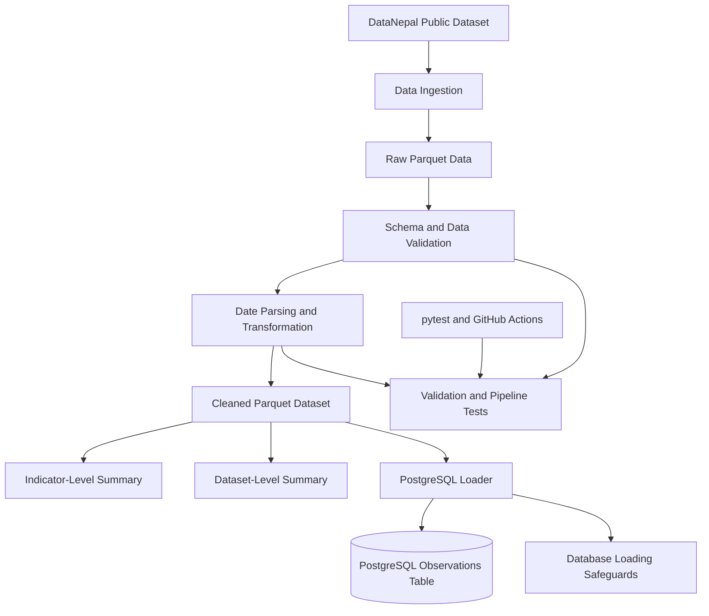

# Nepal Public Data Pipeline

**A Reproducible Data Engineering Pipeline for Public Data from Nepal**

A Python-based data engineering project that transforms public observations about Nepal into validated, analysis-ready data and stores them in Parquet and PostgreSQL. The project demonstrates data ingestion, validation, transformation, analytical summarisation, relational storage, automated testing, and containerised development.


<p align="center">
  <a href="docs/images/nepal-data-pipeline-architecture1.svg">View full-resolution SVG architecture diagram</a>
</p>

## Project at a Glance

| Component | Implementation |
|---|---|
| Programming language | Python |
| Data processing | pandas, PyArrow |
| Analytical storage | Apache Parquet |
| Relational storage | PostgreSQL |
| Containerisation | Docker, Docker Compose |
| Testing | pytest |
| Continuous integration | GitHub Actions |
| Data source | DataNepal public observations dataset |

### Verified Dataset Snapshot

| Metric | Result |
|---|---:|
| Observations processed | 27,182 |
| Dataset columns | 12 |
| Unique indicators | 36 |
| Unique places | 838 |
| Duplicate observation IDs | 0 |
| Duplicate rows | 0 |
| Indicator summary groups | 37 |
| Dataset summary groups | 4 |
| Local automated tests passed | 20/20 |

These figures represent the dataset and local test run verified during development. Results may change if the upstream data or test suite changes.

## 1. Motivation

Public datasets become more useful when they can be processed consistently, checked for structural problems, and prepared for downstream analysis.

This project explores that engineering process using observations about Nepal. Rather than treating a dataset as a file to analyse once, it implements a repeatable workflow that separates ingestion, validation, transformation, storage, and testing.

The project also provides a foundation for future work involving data quality monitoring, incremental data loading, and data-driven applications.

## 2. Architecture and Workflow

The pipeline separates data preparation from database loading so that the analytical workflow can be executed and tested independently.



### Processing stages

1. **Ingestion:** obtains the published Parquet dataset when ingestion is requested and the configured input file is missing.
2. **Validation:** checks required columns, identifiers, values, and observation periods.
3. **Transformation:** parses date fields and writes the cleaned analytical dataset.
4. **Summarisation:** generates indicator-level and dataset-level CSV reports.
5. **Persistence:** loads cleaned observations into PostgreSQL through a separate loader.
6. **Verification:** tests validation rules, pipeline behaviour, transformation outputs, and database-loading safeguards.

## 3. Data Source

The project uses the public observations dataset published by [DataNepal](https://datanepal.org/).

- **Dataset:** [observations.parquet](https://datanepal.org/data/observations.parquet)
- **Format:** Apache Parquet
- **Coverage:** observations from multiple datasets concerning Nepal
- **Example dataset identifiers:** `nso-nphc-2021`, `cod-ps-npl`, `worldbank-npl`, and `ecn-hor-2026`

### Dataset composition

| Dataset ID | Observations |
|---|---:|
| `nso-nphc-2021` | 21,258 |
| `cod-ps-npl` | 4,590 |
| `worldbank-npl` | 1,213 |
| `ecn-hor-2026` | 121 |
| **Total** | **27,182** |

The upstream dataset may be updated independently, so these counts should be treated as a development snapshot rather than permanent totals.

## 4. Data Quality and Validation

The pipeline checks the integrity of incoming observations before downstream processing.

Current validation includes:

- Required-column checks
- Required identifier and status/period field checks
- Duplicate observation ID detection
- Numeric or textual observation-value checks
- Date parsing validation
- Observation-period consistency checks

The ingestion process also validates downloaded data before accepting it as raw input.

These checks help detect malformed or inconsistent records. They do not guarantee the semantic accuracy of every source observation.

## 5. Storage and Analytical Outputs

### Parquet

Parquet is used to retain the raw input and the cleaned analytical dataset. The cleaned output provides a consistent input for summaries and database loading.

### PostgreSQL

PostgreSQL provides relational storage for the cleaned observations. Database loading is a separate operation rather than an automatic part of the default pipeline.

The loader includes a safeguard that stops execution when the target `observations` table already contains records. This prevents accidental duplicate loading, although incremental loading and change detection are not implemented yet.

### Generated artifacts

| Artifact | Purpose |
|---|---|
| `data/raw/observations.parquet` | Raw input dataset |
| `data/processed/observations_clean.parquet` | Validated, cleaned dataset |
| `data/processed/indicator_summary.csv` | Indicator-level summary |
| `data/processed/dataset_summary.csv` | Dataset-level summary |
| `data/processed/data_quality_report.json` | Data quality report from the separate report script |
| `logs/pipeline.log` | Pipeline execution log |
| PostgreSQL `observations` table | Relational storage for cleaned observations |

Actual outputs depend on the scripts executed and the configured paths.

## 6. Reproducibility and Execution

### Requirements

- Python 3.12 or a compatible version
- Git
- Docker Desktop for the containerised PostgreSQL service

### Set up the project

```bash
git clone https://github.com/manish11111111/nepal-data-pipeline.git
cd nepal-data-pipeline
python -m venv .venv
```

Activate the virtual environment.

**Windows PowerShell**

```powershell
.\.venv\Scripts\Activate.ps1
```

**macOS or Linux**

```bash
source .venv/bin/activate
```

Install the dependencies:

```bash
python -m pip install --upgrade pip
pip install -r requirements.txt
```

### Run the pipeline

To ingest the dataset when the configured raw input is missing:

```bash
python src/pipeline.py --ingest
```

If the raw dataset already exists:

```bash
python src/pipeline.py
```

### Available options

| Option | Purpose |
|---|---|
| `--ingest` | Request ingestion when the selected input file is missing |
| `--input PATH` | Select a custom raw input path |
| `--output PATH` | Select a custom cleaned output path |
| `--no-summaries` | Skip summary generation |

Custom input and output paths support isolated processing runs without replacing the default output files.

## 7. PostgreSQL and Docker

Docker Compose defines a PostgreSQL database service and an optional containerised pipeline service.

### Start PostgreSQL

Create a local `.env` file containing:

```dotenv
POSTGRES_PASSWORD=replace_with_a_strong_local_password
```

Do not commit this file or expose database credentials in the repository.

Start the database:

```bash
docker compose up -d db
```

Check the connection:

```bash
python src/check_postgres_connection.py
```

After confirming that the cleaned Parquet file exists, load it into PostgreSQL:

```bash
python src/load_to_postgres.py
```

The default local connection uses database `nepal_data`, user `pipeline_user`, and host port `5433`. Inside Docker Compose, PostgreSQL uses port `5432`.

To run the containerised pipeline:

```bash
docker compose --profile pipeline run --rm pipeline
```

The database loader intentionally refuses to load into an already populated target table. Incremental and upsert-based loading are future improvements.

## 8. Testing and Continuous Integration

The project uses pytest to verify core pipeline behaviour and regression scenarios.

Run the test suite:

```bash
python -m pytest -v
```

The current test suite covers:

- Data validation rules and invalid records
- Missing input handling
- Ingestion behaviour
- Custom input and output paths
- Summary generation and output counts
- PostgreSQL loader success and failure cases
- Duplicate-loading protection
- Row-count consistency checks

**Latest recorded local result: 20 tests passed.**

The repository also uses GitHub Actions to run tests on Python 3.12.

- [View source code and project history](https://github.com/manish11111111/nepal-data-pipeline)
- [View GitHub Actions runs](https://github.com/manish11111111/nepal-data-pipeline/actions)

The live Actions status should be checked directly on GitHub.

## 9. Engineering Decisions

**Separation of concerns:** ingestion, validation, transformation, and database loading have distinct responsibilities, making individual stages easier to test and maintain.

**Validation before downstream processing:** malformed records are detected before they are used to produce analytical outputs.

**Columnar analytical storage:** Parquet provides a practical format for storing and processing structured datasets.

**Relational persistence:** PostgreSQL makes cleaned observations available through a relational database.

**Safe database loading:** a populated target table triggers an explicit failure rather than an accidental second load.

**Configurable execution:** custom input and output paths make isolated testing and experimentation possible.

**Automated regression testing:** pytest and GitHub Actions help detect regressions as the code evolves.

## 10. Limitations and Future Work

The current implementation is a local, reproducible data pipeline rather than a production-scale orchestration platform.

Planned improvements include:

- Stronger schema contracts and explicit type checks
- Dataset version tracking and ingestion timestamps
- Incremental loading and change detection
- More database integration tests
- Docker-based CI verification
- Data freshness and quality metrics
- A small sample dataset and end-to-end demonstration
- Scheduling and orchestration
- A dashboard for exploring indicators and datasets

## 11. Relevance to Data Engineering and AI

This project demonstrates foundational engineering work relevant to data-intensive systems: acquiring structured data, validating records, transforming datasets, managing analytical and relational storage, and verifying pipeline behaviour through automated tests.

It is a foundation for future data-driven and AI applications because reliable downstream analysis depends on consistent, well-structured, and validated data.

The current project focuses on **data engineering fundamentals**. It does not claim to implement a machine-learning model or a production AI system.

## 12. Data Attribution and Licensing

The data is sourced from [DataNepal](https://datanepal.org/), which aggregates observations from multiple providers. Review the relevant upstream terms, attribution requirements, and data licences before redistributing data.

This repository does not currently include a `LICENSE` file. No open-source licence should be assumed for the project code.

## Author

**Manish Chapagain**  
Computer Engineering graduate interested in data engineering, artificial intelligence, and data-driven applications.

- [GitHub](https://github.com/manish11111111)
- [LinkedIn](https://linkedin.com/in/manish-chapagain-467451284)
