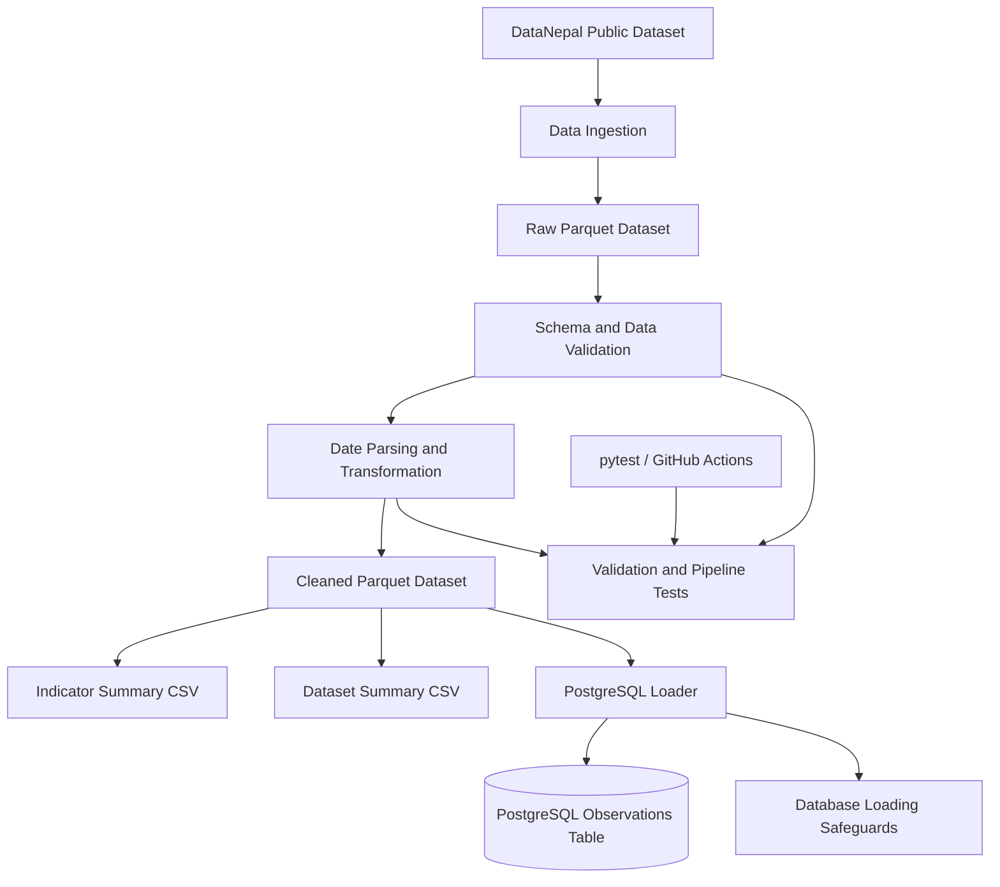

# Nepal Public Data Pipeline

**A Reproducible Data Engineering Pipeline for Public Data from Nepal**

A Python-based data engineering project that ingests, validates, transforms, and stores public observations about Nepal using **pandas, Apache Parquet, PostgreSQL, Docker, and pytest**. It demonstrates a reproducible data workflow with data-quality checks, analytical summaries, relational storage, and automated testing.

<p align="center">
  
</p>

<p align="center">
  <a href="docs/images/nepal-data-pipeline-architecture1.svg">View full-resolution architecture diagram</a>
</p>

## Table of Contents

- [Project Overview](#project-overview)
- [Key Features](#key-features)
- [Technology Stack](#technology-stack)
- [Architecture and Workflow](#architecture-and-workflow)
- [Data Source](#data-source)
- [Data Quality and Validation](#data-quality-and-validation)
- [Storage and Outputs](#storage-and-outputs)
- [Getting Started](#getting-started)
- [Running with Docker](#running-with-docker)
- [PostgreSQL Data Loading](#postgresql-data-loading)
- [Testing](#testing)
- [Verified Results](#verified-results)
- [Engineering Decisions](#engineering-decisions)
- [Limitations and Future Improvements](#limitations-and-future-improvements)
- [Data Attribution and Licensing](#data-attribution-and-licensing)
- [Author](#author)

## Project Overview

Public datasets become more useful when they can be processed consistently, checked for structural problems, and prepared for downstream analysis.

This project implements a repeatable data pipeline using public observations about Nepal. It separates ingestion, validation, transformation, analytical summarisation, and database loading into distinct stages so that the workflow can be tested and maintained more easily.

The project focuses on **data engineering fundamentals** rather than machine-learning model development. It provides a foundation for future data-driven applications by making structured data available in validated analytical and relational formats.

## Key Features

- **Data ingestion:** retrieves a public Parquet dataset when the configured raw input is missing and ingestion is requested.
- **Data validation:** checks required columns, missing values, duplicate observation IDs, observation values, and date consistency.
- **Data transformation:** parses observation-period dates and writes a cleaned Parquet dataset.
- **Analytical summaries:** generates indicator-level and dataset-level CSV reports.
- **Data-quality reporting:** produces a report with dataset statistics and quality checks.
- **Relational storage:** stores observations in PostgreSQL.
- **Database loading safeguards:** prevents accidental loading into a target table that already contains records.
- **Containerised execution:** uses Docker Compose for PostgreSQL and an optional pipeline container.
- **Automated testing:** uses pytest to test pipeline, transformation, and database-loader behaviour.

## Technology Stack

| Component | Technology |
|---|---|
| Language | Python |
| Data processing | pandas |
| Columnar data format | Apache Parquet |
| Parquet engine | PyArrow |
| Relational database | PostgreSQL |
| Database driver | psycopg |
| Containerisation | Docker, Docker Compose |
| Testing | pytest |
| Continuous integration | GitHub Actions |
| Public data source | DataNepal |

## Architecture and Workflow

The pipeline separates data preparation from database loading. This allows the data-processing workflow to run independently of the database persistence step.



### Processing stages

1. **Ingestion:** obtains the published dataset when ingestion is requested and the raw input file is missing.
2. **Validation:** checks required columns, identifiers, observation values, and observation periods.
3. **Transformation:** parses date fields and writes the cleaned Parquet output.
4. **Summarisation:** generates indicator-level and dataset-level CSV reports.
5. **Persistence:** loads cleaned observations into PostgreSQL through a separate loader.
6. **Verification:** uses automated tests and database checks to evaluate pipeline behaviour and data integrity.

## Data Source

The project uses the public observations dataset published by [DataNepal](https://datanepal.org/).

- **Dataset:** [observations.parquet](https://datanepal.org/data/observations.parquet)
- **Format:** Apache Parquet
- **Coverage:** observations from multiple datasets concerning Nepal

### Dataset composition

The following counts represent the dataset snapshot processed during development.

| Dataset ID | Observations | Status |
|---|---:|---|
| `nso-nphc-2021` | 21,258 | Actual |
| `cod-ps-npl` | 4,590 | Projection |
| `worldbank-npl` | 1,213 | Actual |
| `ecn-hor-2026` | 121 | Actual |
| **Total** | **27,182** | |

The upstream dataset can change independently. These figures should therefore be treated as a development snapshot rather than permanent totals.

## Data Quality and Validation

The pipeline validates incoming observations before producing downstream outputs.

Current validation includes:

- Required-column checks
- Missing-value checks for required identifiers and fields
- Duplicate observation ID detection
- Numeric or textual observation-value checks
- Date parsing and invalid-date detection
- Observation-period consistency checks

A separate data-quality report provides additional information about dataset composition, missing values, duplicates, and numeric values.

These checks help detect structural and consistency problems. They do not guarantee the semantic accuracy of every observation published by an upstream source.

## Storage and Outputs

### Apache Parquet

Parquet stores the raw input and the cleaned analytical dataset. The cleaned dataset provides a consistent input for summaries and database loading.

### PostgreSQL

PostgreSQL provides relational storage for cleaned observations. Database loading is a separate operation rather than an automatic part of the standard transformation pipeline.

The loader stops when the target `observations` table already contains records. This safeguard helps prevent accidental duplicate loading. Incremental loading and upsert-based change handling are not currently implemented.

### Generated artifacts

| Artifact | Purpose |
|---|---|
| `data/raw/observations.parquet` | Raw input dataset |
| `data/processed/observations_clean.parquet` | Validated, cleaned dataset |
| `data/processed/indicator_summary.csv` | Indicator-level summary |
| `data/processed/dataset_summary.csv` | Dataset-level summary |
| `data/processed/data_quality_report.json` | Data-quality report |
| `logs/pipeline.log` | Pipeline execution log |
| PostgreSQL `observations` table | Relational storage for cleaned observations |

The data and log files are generated locally and are not necessarily tracked in Git. Actual outputs depend on the scripts executed and the configured paths.

## Getting Started

### Prerequisites

- Python 3.12 or another compatible Python version
- Git
- Docker Desktop for the containerised PostgreSQL setup

### 1. Clone the repository

```bash
git clone https://github.com/manish11111111/nepal-data-pipeline.git
cd nepal-data-pipeline
```

### 2. Create a virtual environment

```bash
python -m venv .venv
```

Activate the environment.

**Windows PowerShell**

```powershell
.\.venv\Scripts\Activate.ps1
```

**macOS or Linux**

```bash
source .venv/bin/activate
```

If PowerShell blocks activation, use the environment's Python executable directly:

```powershell
.\.venv\Scripts\python.exe -m pip install -r requirements.txt
```

### 3. Install dependencies

```bash
python -m pip install --upgrade pip
python -m pip install -r requirements.txt
```

### 4. Run the pipeline

If the raw dataset already exists:

```bash
python src/pipeline.py
```

To request ingestion when the raw input is missing:

```bash
python src/pipeline.py --ingest
```

The pipeline validates the data, writes the cleaned Parquet dataset, and generates the summary reports.

### Available pipeline options

| Option | Description |
|---|---|
| `--ingest` | Download the dataset only if the selected raw input is missing |
| `--input PATH` | Specify a custom raw input path |
| `--output PATH` | Specify a custom cleaned output path |
| `--no-summaries` | Skip summary CSV generation |

Custom input and output paths support isolated processing runs without replacing the default output files.

## Running with Docker

Docker Compose defines a PostgreSQL service and an optional containerised pipeline service.

### 1. Configure the database password

Create a `.env` file in the project root:

```dotenv
POSTGRES_PASSWORD=replace_with_a_strong_local_password
```

Replace the example value with your own strong local password. Do not commit `.env` or share database credentials.

### 2. Start PostgreSQL

```bash
docker compose up -d db
```

Check the service status:

```bash
docker compose ps
```

The database should report a healthy status before dependent operations are run.

### 3. Build the pipeline image

```bash
docker compose --profile pipeline build pipeline
```

### 4. Run the containerised pipeline

```bash
docker compose --profile pipeline run --rm pipeline python src/pipeline.py
```

This command runs the data-processing pipeline inside a temporary container and removes that container after execution. The configured data and log directories are mounted from the project directory.

The transformation pipeline does **not** automatically load observations into PostgreSQL.

### Database connection settings

| Setting | Value |
|---|---|
| Database | `nepal_data` |
| Database user | `pipeline_user` |
| Host port | `5433` |
| Container port | `5432` |
| Compose database hostname | `db` |

To check the local database connection:

```bash
python src/check_postgres_connection.py
```

The connection-check script prompts for the password if it is not supplied through the configured environment.

## PostgreSQL Data Loading

After the cleaned Parquet file has been generated and the database is available, the loader can be run separately:

```bash
python src/load_to_postgres.py
```

The loader reads the cleaned dataset and writes observations into the PostgreSQL `observations` table.

**Important:** the loader intentionally refuses to load data when the target table already contains records. Do not drop or truncate an existing table just to rerun the loader. Inspect the current database state first.

The project currently uses a full initial-load workflow. Incremental ingestion, upserts, and automated reconciliation between changed source data and existing database records remain future improvements.

## Testing

Run the automated test suite with pytest:

```bash
python -m pytest -v
```

The test suite covers core pipeline behaviour, including:

- Data validation rules and invalid records
- Missing-input handling
- Ingestion behaviour
- Custom input and output paths
- Summary generation and output counts
- PostgreSQL loader success and failure cases
- Duplicate-loading protection
- Row-count consistency checks

### Continuous integration

The repository includes a GitHub Actions workflow intended to run tests using Python 3.12.

- [View the GitHub repository](https://github.com/manish11111111/nepal-data-pipeline)
- [View GitHub Actions runs](https://github.com/manish11111111/nepal-data-pipeline/actions)

Check the Actions page for the current status of remote CI runs. A successful local test run does not, by itself, establish that the latest GitHub Actions workflow passed.

## Verified Results

The following results were observed during local and Docker-based development verification.

| Check | Verified result |
|---|---:|
| Raw observations processed | 27,182 |
| Cleaned observations | 27,182 |
| Dataset columns | 12 |
| Unique indicators | 36 |
| Unique places | 838 |
| Duplicate observation IDs in the dataset | 0 |
| Duplicate rows in the dataset | 0 |
| Invalid observation-period ranges | 0 |
| Rows without numeric or textual values | 0 |
| Indicator summary groups | 37 |
| Dataset summary groups | 4 |
| Local automated tests | 20 passed |
| Docker image build | Successful |
| Docker pipeline execution | Successful |

### PostgreSQL integrity verification

The PostgreSQL table was inspected and checked against the cleaned Parquet dataset.

- PostgreSQL contained 27,182 observations.
- All 27,182 observation IDs were unique and non-null.
- Dataset and status counts matched the expected distribution.
- Required database fields contained no missing values.
- No invalid date ranges were detected.
- No rows were missing both numeric and textual values.
- A row-by-row comparison of all 12 columns reported that every value matched between the cleaned Parquet dataset and PostgreSQL.

These results apply to the specific dataset snapshot tested during development. They are not a guarantee that future upstream data will produce identical counts or values.

## Engineering Decisions

### Separation of concerns

Ingestion, validation, transformation, and database loading are separate operations. This makes the code easier to test and allows the data-preparation workflow to run without database writes.

### Validation before downstream processing

The pipeline checks data structure and consistency before generating analytical outputs.

### Columnar analytical storage

Parquet is used as the analytical storage format for structured observations and processed data.

### Relational persistence

PostgreSQL makes cleaned observations available for relational queries and downstream applications.

### Safe initial loading

The database loader refuses to write into an already populated target table instead of silently inserting duplicate records.

### Reproducible execution

Python dependencies, Docker configuration, and automated tests help make development and verification repeatable.

## Limitations and Future Improvements

This project is a local, reproducible data pipeline rather than a production-scale orchestration platform.

Potential improvements include:

- Stronger schema contracts and explicit type validation
- Dataset version tracking and ingestion timestamps
- Incremental loading and change detection
- Upsert-based database synchronisation
- Expanded database integration tests
- Docker-based CI verification
- Data freshness monitoring and quality metrics
- A small sample dataset for easier local testing
- Workflow scheduling and orchestration
- A dashboard for exploring indicators and datasets

## Data Attribution and Licensing

The data is sourced from [DataNepal](https://datanepal.org/), which aggregates observations from multiple providers.

- [DataNepal website](https://datanepal.org/)
- [Public observations dataset](https://datanepal.org/data/observations.parquet)

Review the applicable upstream terms, attribution requirements, and data licences before redistributing data.

This repository does not currently include a `LICENSE` file. No open-source licence should be assumed for the project code unless one is explicitly added.

## Author

**Manish Chapagain**

Computer Engineering graduate interested in data engineering, artificial intelligence, and data-driven applications.

- [GitHub](https://github.com/manish11111111)
- [LinkedIn](https://linkedin.com/in/manish-chapagain-467451284)
