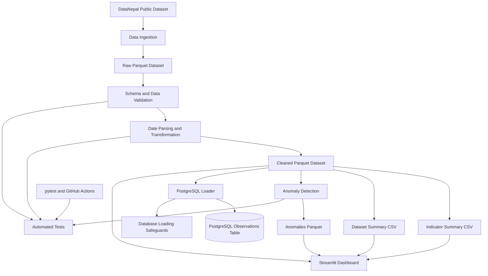

# Nepal Public Data Pipeline

**A Reproducible Data Engineering Pipeline for Public Data from Nepal**

A Python-based data engineering project that ingests, validates, transforms, summarizes, and stores public observations about Nepal using pandas, Apache Parquet, PostgreSQL, Docker, pytest, Streamlit, Plotly, and scikit-learn.

The project demonstrates practical data engineering concepts, including data-quality validation, analytical transformations, relational storage, containerized execution, automated testing, continuous integration, anomaly detection, and interactive data visualization.

## Table of Contents

- [Project Overview](#project-overview)
- [Key Features](#key-features)
- [Technology Stack](#technology-stack)
- [Architecture and Workflow](#architecture-and-workflow)
- [Streamlit Dashboard](#streamlit-dashboard)
- [Anomaly Detection](#anomaly-detection)
- [Data Source](#data-source)
- [Data Validation](#data-validation)
- [Generated Outputs](#generated-outputs)
- [Getting Started](#getting-started)
- [Running with Docker](#running-with-docker)
- [Loading Data into PostgreSQL](#loading-data-into-postgresql)
- [Testing and Continuous Integration](#testing-and-continuous-integration)
- [Verified Results](#verified-results)
- [Engineering Decisions](#engineering-decisions)
- [Limitations and Future Improvements](#limitations-and-future-improvements)
- [Data Attribution and Licensing](#data-attribution-and-licensing)
- [Author](#author)

## Project Overview

Public datasets become more useful when they can be processed consistently, checked for structural problems, and prepared for downstream analysis.

This project implements a repeatable pipeline for public observations about Nepal. It separates ingestion, validation, transformation, analytical summarization, anomaly detection, database loading, and dashboard presentation into distinct stages.

The standard pipeline produces cleaned analytical data and summary reports. A separate database loader supports persistence in PostgreSQL, while an interactive Streamlit dashboard presents pipeline outputs and data-quality signals.

The primary focus is **data engineering fundamentals**. Anomaly detection is included as a data-quality aid rather than as a predictive modeling system.

## Key Features

- **Data ingestion:** Downloads a public Parquet dataset and validates its structure before saving it.
- **Data validation:** Checks required columns, missing identifiers, duplicate observation IDs, observation values, and date consistency.
- **Data transformation:** Parses observation-period dates and writes cleaned Parquet data.
- **Analytical summaries:** Generates indicator-level and dataset-level CSV reports.
- **Anomaly detection:** Uses Isolation Forest to flag unusual numeric values.
- **PostgreSQL integration:** Loads cleaned observations into a relational database through a separate loader.
- **Safe loading:** Includes safeguards to prevent accidental loading into an already populated target table.
- **Interactive dashboard:** Presents dataset summaries, indicator summaries, observation exploration, and data-quality information.
- **Docker support:** Supports containerized PostgreSQL and pipeline execution through Docker Compose, where configured.
- **Automated testing:** Uses pytest to test pipeline components and data-processing behavior.
- **Continuous integration:** Uses GitHub Actions to automate tests on configured pushes and pull requests.

## Technology Stack

| Component | Technology |
|---|---|
| Programming language | Python |
| Data processing | pandas |
| Analytical storage | Apache Parquet |
| Parquet engine | PyArrow |
| Relational database | PostgreSQL |
| Database driver | psycopg |
| Anomaly detection | scikit-learn, Isolation Forest |
| Dashboard | Streamlit |
| Visualization | Plotly |
| Containerization | Docker, Docker Compose |
| Testing | pytest |
| Continuous integration | GitHub Actions |
| Data source | DataNepal |

## Architecture and Workflow

The project separates data preparation, anomaly detection, database persistence, and dashboard presentation.



### Processing Stages

1. **Ingestion:** Retrieves the upstream dataset when ingestion is requested and the raw input file needs to be created or refreshed.
2. **Validation:** Checks required fields, identifiers, observation values, and observation-period consistency.
3. **Transformation:** Parses date fields and writes the cleaned Parquet output.
4. **Summarization:** Produces indicator-level and dataset-level CSV reports.
5. **Anomaly detection:** Identifies potentially unusual numeric observations using Isolation Forest.
6. **Persistence:** Loads cleaned observations into PostgreSQL through a separate database loader.
7. **Presentation:** Displays available pipeline outputs through a Streamlit dashboard.
8. **Verification:** Uses automated tests and database checks to evaluate correctness and data integrity.

## Streamlit Dashboard

The dashboard provides an interactive interface for exploring the pipeline's outputs.

| Page | Purpose |
|---|---|
| Home | Project overview, key metrics, and anomaly summary |
| Dataset | Dataset-level aggregates and charts |
| Indicators | Indicator-level aggregates, observation counts, and value statistics |
| Explore | Filtered exploration of cleaned observations and CSV export |
| Quality | Data-quality checks and anomaly detection results |
| About | Project context, pipeline stages, technologies, and author information |

Run the dashboard from the project root:

```powershell
streamlit run app.py
```

The dashboard is intended for read-only exploration. It should not modify source observations or database records.

## Anomaly Detection

The anomaly detection component uses **Isolation Forest** to flag potentially unusual numeric observation values.

- **Per-indicator analysis:** Fits a model for an indicator when sufficient observations are available.
- **Fallback handling:** Uses a global model for indicators with too few observations, if implemented by the current detection module.
- **Output:** `data/processed/anomalies.parquet`, with an additional `is_anomaly` column when generated by the configured pipeline.

Run the module from the project root:

```powershell
python -m src.anomaly_detection
```

The results can be explored through the dashboard's Quality page when the output file is available.

Anomaly detection is a **data-quality signal, not a predictive model**. Unusual values are not necessarily incorrect; they should be investigated in the context of their indicator, source, and observation period.

## Data Source

The project uses public observations published by [DataNepal](https://datanepal.org/).

- **Dataset:** [observations.parquet](https://datanepal.org/data/observations.parquet)
- **Format:** Apache Parquet
- **Coverage:** Observations from multiple datasets concerning Nepal

The ingestion code may reference dataset identifiers such as:

- `nso-nphc-2021`
- `cod-ps-npl`
- `worldbank-npl`
- `ecn-hor-2026`

Confirm these identifiers against the current ingestion code and upstream data before relying on them. The upstream dataset can change independently, so row counts and dataset composition should be treated as a snapshot rather than permanent values.

## Data Validation

The pipeline validates incoming observations before generating downstream outputs.

Validation includes checks such as:

- Required-column validation
- Missing-value checks for required identifiers and fields
- Duplicate observation ID detection
- Observation-value validation
- Date parsing and invalid-date detection
- Observation-period consistency, including end dates preceding start dates

These checks help detect structural and consistency problems. They do not guarantee the semantic accuracy of every observation published by an upstream source.

## Generated Outputs

The pipeline produces analytical artifacts under the project's data directories.

| Output | Purpose |
|---|---|
| `data/raw/observations.parquet` | Raw input dataset |
| `data/processed/observations.parquet` | Cleaned observations |
| Indicator summary CSV | Indicator-level statistics |
| Dataset summary CSV | Dataset-level statistics |
| `data/processed/anomalies.parquet` | Observations annotated with anomaly flags, when generated |

Check the current source code for the exact summary CSV filenames and output paths before relying on this list.

Generated data files are generally excluded from version control so that the repository stays focused on source code, tests, configuration, and documentation.

## Getting Started

### Prerequisites

Install the following tools:

- Python version supported by the project and its dependencies
- Git
- Docker Desktop, if you intend to run the containerized services
- PostgreSQL, if you intend to run the database integration outside Docker

### 1. Clone the Repository

```powershell
git clone https://github.com/manish11111111/nepal-data-pipeline.git
cd nepal-data-pipeline
```

If the Python project files are nested inside another directory in your local checkout, change into the directory containing `pyproject.toml` or the project's dependency file before continuing.

### 2. Create a Virtual Environment

```powershell
python -m venv .venv
```

Activate it in PowerShell:

```powershell
.\.venv\Scripts\Activate.ps1
```

If PowerShell blocks activation, you can invoke the virtual environment's Python executable directly instead.

### 3. Install Dependencies

If the repository includes `requirements.txt`:

```powershell
python -m pip install -r requirements.txt
```

If dependencies are defined through another project configuration file, use the installation instructions associated with that configuration.

### 4. Run the Pipeline

Use the project's documented entry point. For example, if `src.pipeline` is the configured entry point:

```powershell
python -m src.pipeline
```

The pipeline should create the cleaned dataset and summary outputs according to the current configuration.

If the raw input must be downloaded separately, use the ingestion command supported by the current implementation.

## Running with Docker

Docker Compose can be used to start the services defined in the repository's Compose configuration.

First, inspect the available services:

```powershell
docker compose config --services
```

Start the configured services:

```powershell
docker compose up --build
```

Run this from the directory containing the Compose file. The actual service names, environment variables, ports, and startup commands depend on the repository's configuration.

Stop the services when finished:

```powershell
docker compose down
```

Persistent database volumes may retain data after containers stop. Remove volumes only when you intentionally want to delete the stored database data.

## Loading Data into PostgreSQL

The PostgreSQL loader is separate from the standard transformation pipeline.

Before loading, ensure that:

1. PostgreSQL is running.
2. The database and target table configuration are correct.
3. The cleaned Parquet dataset exists.
4. Required connection settings are provided through the supported environment variables or configuration.

Use the database-loading command documented by the current implementation. Do not place passwords or other credentials directly in source code or commit them to Git.

The loader includes a safeguard against loading into an already populated target table. Review the loader's behavior before rerunning it against an existing database.

After loading, verify the row count and identifier integrity using SQL or the project's database-checking script.

## Testing and Continuous Integration

The project uses pytest for automated testing.

Run the test suite from the project root:

```powershell
python -m pytest
```

Check for whitespace errors and inspect the working tree before committing:

```powershell
git diff --check
git status --short
```

If GitHub Actions is configured for the repository, pushes and pull requests targeting the configured branch can trigger the automated test workflow.

## Verified Results

The following results were observed during local verification of an earlier project snapshot:

| Check | Result |
|---|---:|
| Processed observations | 27,182 |
| Indicator summary rows | 37 |
| Dataset summary rows | 4 |
| PostgreSQL observation rows verified | 27,182 |

These figures describe that verified snapshot, not a guarantee about future runs. Results can change when the upstream dataset, code, environment, or configuration changes.

## Engineering Decisions

### Parquet for Analytical Storage

Parquet provides a columnar format suited to analytical data workflows. It preserves structured data while supporting efficient reads of selected columns.

### Separate Processing and Persistence

Keeping transformation logic separate from the database loader allows the data-processing pipeline to run without requiring PostgreSQL for every execution.

### Automated Validation

Schema and consistency checks catch common data issues early, before they propagate into analytical outputs.

### Database Loading Safeguards

Preventing accidental repeated loads reduces the risk of duplicate records and unintended changes to an existing database.

### Anomaly Detection as a Supporting Signal

Isolation Forest helps identify observations worth reviewing. It complements, rather than replaces, explicit validation rules and domain knowledge.

## Limitations and Future Improvements

Potential future improvements include:

- Add data-quality metrics and validation reports for each pipeline run.
- Introduce structured logging and more informative failure messages.
- Add configurable retry logic and clearer handling of upstream download failures.
- Make database loading transactional and support explicitly controlled incremental updates.
- Add schema versioning and stronger reproducibility controls.
- Track data lineage and record source retrieval timestamps.
- Add dashboard filters and performance improvements for larger datasets.
- Expand tests to cover edge cases, invalid input, and database failure scenarios.
- Add deployment documentation and automated checks for dashboard functionality.

These are potential improvements, not claims that the features are already implemented.

## Data Attribution and Licensing

The upstream observations are provided by [DataNepal](https://datanepal.org/). Refer to the original dataset's documentation and applicable license for attribution and permitted use.

This repository's code and the upstream dataset may have different licensing terms. Check the repository's license and the source dataset's terms before redistributing either.

## Author

**Manish Chapagain**

Computer Engineering graduate interested in data engineering, analytics, and artificial intelligence.

- GitHub: [manish11111111](https://github.com/manish11111111)
- Project Repository: [nepal-data-pipeline](https://github.com/manish11111111/nepal-data-pipeline)
